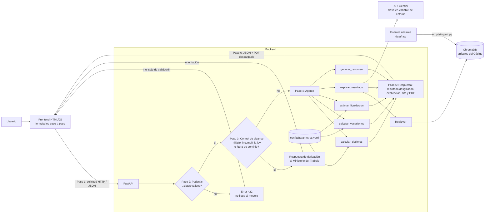

# 03 · Diseño de la arquitectura

Arquitectura en capas: un backend FastAPI expone la API y sirve un frontend HTML/JS simple. Los cálculos viven en código determinista; el modelo solo redacta explicaciones a partir de datos que el backend le entrega.

## 1. Componentes

## 2. Flujo de una consulta de principio a fin

Ejemplo: un trabajador quiere saber su décimo tercero.

1. Completa el formulario (remuneraciones del período) y lo envía.
2. FastAPI valida la entrada con Pydantic. Si hay un salario negativo o una fecha futura, responde **422** y el modelo nunca se llama.
3. **Antes de ejecutar cualquier herramienta**, el control de alcance (guardrail) revisa la consulta. Si es litigiosa, pide incumplir la ley o está fuera del dominio, el flujo termina con una respuesta de derivación al Ministerio del Trabajo y ninguna herramienta se ejecuta.
4. El agente llama a `calcular_decimos`, que lee el salario básico y los períodos de `config/parametros.yaml` y devuelve el resultado desglosado.
5. `explicar_resultado` pide al retriever el artículo aplicable (art. 111) a ChromaDB, filtrando por metadatos.
6. Se arma el prompt con el resultado numérico ya calculado y el fragmento del artículo **delimitado como datos**. Gemini redacta la explicación y cita el artículo. Si no se recuperó ningún artículo, el sistema dice que no tiene fuente verificable.
7. El frontend muestra el desglose, la explicación y la fuente. El usuario puede pedir el resumen en PDF (`generar_resumen`).

## 3. Herramientas del agente (definidas por el caso)

| Herramienta | Entrada | Qué hace | Tipo |
|---|---|---|---|
| `calcular_decimos(remuneraciones, periodo)` | montos por mes, período, región | Décimo tercero y décimo cuarto | Determinista, solo lectura |
| `calcular_vacaciones(fecha_ingreso, remuneracion)` | fechas, remuneración | Días y valor de vacaciones | Determinista, solo lectura |
| `estimar_liquidacion(datos)` | fechas, remuneración, motivo de salida, horas extra | Rubros y total (incluye horas suplementarias y extraordinarias) | Determinista, solo lectura |
| `explicar_resultado(calculo)` | resultado ya calculado | Explicación con cita del artículo recuperado | Modelo + RAG, no calcula |
| `generar_resumen(datos)` | entradas y resultados | PDF descargable | Determinista; se genera solo cuando el usuario lo pide |

Límites: máximo de iteraciones del agente, rechazo de consultas fuera de dominio y ninguna herramienta ejecuta SQL ni comandos generados por el modelo.

## 4. Qué va en código, en configuración y en el modelo

| Elemento | Dónde vive |
|---|---|
| Fórmulas de décimos, vacaciones, horas y liquidación | Código (`app/tools/`), con pruebas |
| Salario básico, recargos, períodos, topes | `config/parametros.yaml` |
| Texto de la norma | Base vectorial (ChromaDB), a partir de `data/raw/` |
| Redacción de la explicación en lenguaje sencillo | Modelo generativo |
| Decisión de derivar un caso | Guardrail en código + instrucción del prompt |

## 5. Tecnologías

| Capa | Tecnología |
|---|---|
| Backend | Python 3.11+ con FastAPI |
| Validación | Pydantic |
| Pruebas | pytest |
| Modelo | Gemini Flash (capa gratuita) |
| Embeddings y base vectorial | Embeddings de Gemini + ChromaDB con persistencia en disco |
| Frontend | HTML + JavaScript servido por FastAPI |
| Despliegue | Render, Railway o Hugging Face Spaces |
