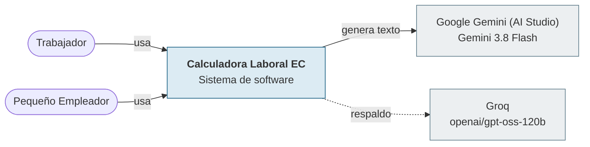
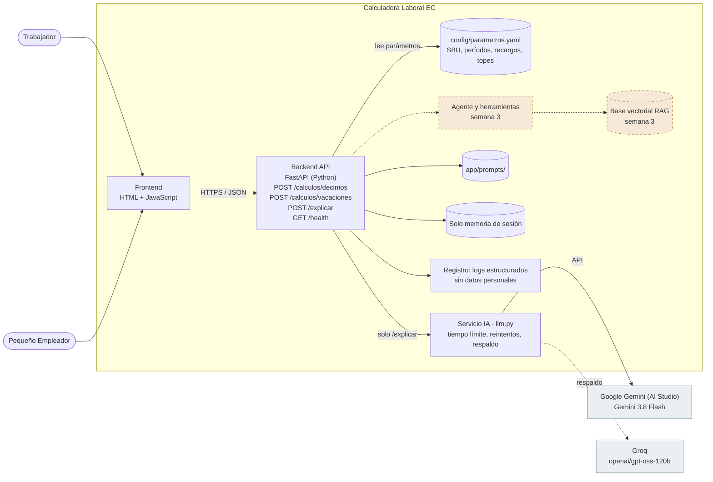
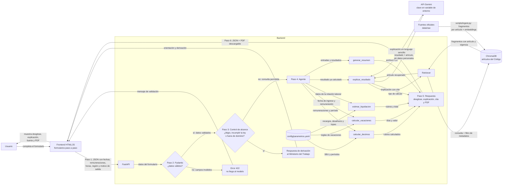

# Arquitectura · Calculadora Laboral EC

**Caso 07:** Calculadora Inteligente de Beneficios y Liquidaciones Laborales
**Tipo de producto:** Automatización de proceso con agente
**Repositorio:** https://github.com/AlexGuerreroR/calculadora-laboral-ec
**Etapa:** Semana 2 · Construcción del MVP e integración con IA generativa

> Este documento tiene dos partes. La **parte A** describe el MVP de la semana 2 (C4 niveles 1 y 2), generado con la plantilla *Estudio de Arquitectura del MVP* y ajustado por el grupo. La **parte B** conserva el diseño completo de la semana 1, que se implementa en las semanas 3 y 4.

## Problema

Los trabajadores consultados (12 de 15 en nuestro levantamiento) no saben cómo se calculan sus décimos, vacaciones, horas adicionales y liquidación. Hoy aceptan el monto que les indican sin poder verificarlo o usan calculadoras sin fuente. El sistema calcula cada valor con código verificado y explica el resultado en lenguaje sencillo, para trabajadores y pequeños empleadores.

## Equipo

| Integrante | Rol (lunes 19) |
|---|---|
| Alexander Guerrero | Tech Lead |
| Bladimir Velasco | Builder |
| Dorian Zambrano | QA / Seguridad |

Los roles rotan cada día.

---

# Parte A · MVP de la semana 2

## Diagrama de contexto (C4 nivel 1)

**Qué muestra:** quién usa el sistema y con qué sistemas externos habla. **Qué deja fuera:** cómo está construido por dentro (eso es el nivel 2). El sistema no se conecta a ningún portal del Ministerio del Trabajo; las fuentes oficiales se descargan y se indexan en la semana 3.

## Diagrama de contenedores (C4 nivel 2)

Los elementos con borde punteado naranja llegan en la semana 3. El nodo `config/parametros.yaml` lo agregó el grupo: la plantilla no lo dibuja, pero el caso exige que los parámetros variables vivan en configuración.

En C4, un **contenedor** es una aplicación o un almacén de datos, no un contenedor de Docker.

## Flujo de una consulta en el MVP

Patrón: **cálculo en código + IA que explica** (ADR-002). El orden de los pasos lo decide el código, no el modelo.

1. El usuario llena el formulario (por ejemplo, remuneraciones del período para el décimo tercero).
2. El frontend envía JSON a `POST /calculos/decimos`.
3. FastAPI valida la entrada con Pydantic. Si faltan datos obligatorios o son inválidos (salario negativo, fecha futura, fecha de salida anterior a la de ingreso), responde **422** y el modelo nunca se llama. Los períodos parciales sí se aceptan, porque permiten calcular valores proporcionales..
4. La función de cálculo lee los parámetros de `config/parametros.yaml` y devuelve el valor con su desglose. **Este paso no consume cuota del modelo.**
5. El frontend muestra el resultado y, si el usuario pide la explicación, envía ese resultado ya calculado a `POST /explicar`.
6. `llm.py` llama a Gemini con el prompt `app/prompts/system_v1.md`, temperatura 0.2 y un máximo de 600 tokens. Ante un 429, un 5xx o un tiempo agotado, reintenta con esperas de 1, 2 y 4 s y luego pasa a Groq. Todo el proceso (intentos, esperas y respaldo) tiene un límite total de 20 s: cada intento usa solo el tiempo que queda de ese presupuesto.
7. El modelo devuelve la explicación en JSON con esquema. Si ambos proveedores fallan, el usuario igual ve el cálculo, con el aviso «La explicación no está disponible por ahora».
8. Cada llamada registra fecha, endpoint, proveedor, modelo, tokens de entrada y salida, milisegundos y resultado, sin sueldos ni datos personales.

## Tecnologías

| Contenedor | Tecnología |
|---|---|
| Frontend | HTML + JavaScript, servido por FastAPI |
| Backend | FastAPI (Python) con Pydantic |
| Datos | Solo memoria de sesión (no se guarda nada del usuario) |
| Configuración | `config/parametros.yaml` |
| Modelo principal | Google Gemini (AI Studio) · Gemini 3.8 Flash |
| Modelo de respaldo | Groq · openai/gpt-oss-120b |
| Patrón de integración | Cálculo en código + IA que explica |
| Registro | Logs estructurados sin datos personales |
| Pruebas | pytest, con un doble del modelo (sin internet ni cuota) |
| Despliegue previsto | Render |

## Endpoints

| Método | Ruta | Propósito |
|---|---|---|
| POST | `/calculos/decimos` | Remuneraciones, período y región → valor del décimo con desglose. Sin modelo |
| POST | `/calculos/vacaciones` | Fecha de ingreso y remuneración → días y valor. Sin modelo |
| POST | `/explicar` | Un resultado ya calculado → explicación en lenguaje sencillo (JSON con esquema) |
| GET | `/health` | Estado del servicio |

## Prompts versionados

| Archivo | Qué cambia en esta versión |
|---|---|
| `app/prompts/system_v1.md` | Explica el resultado recibido sin recalcular ni inventar datos. |

Las versiones v2 y v3 y su comparación se documentan en `docs/05-prompts.md` (miércoles 21).

## Requisitos no funcionales de IA

| Requisito | Presupuesto | Justificación |
|---|---|---|
| Tiempo de respuesta normal (objetivo) | ≤ 8 s | La explicación es corta. Es una meta por comprobar en las pruebas con tiempos medidos |
| Tiempo máximo total de `/explicar` | 20 s | Incluye intentos, esperas de reintento y proveedor de respaldo (`LLM_TIMEOUT_SECONDS`). Si se supera, se muestra el cálculo y se informa que la explicación no está disponible |
| Tokens máximos de salida | 600 | Un párrafo con el desglose; limita costo y divagación |
| Temperatura | 0.2 | Tarea de explicación fiel, no creativa |
| Caracteres máximos de entrada | 2000 | Al modelo solo llega el resultado ya calculado |
| Solicitudes por minuto por usuario | 4 | Gemini permite 5 por minuto por clave (consultado el 19/10/2026); se deja margen para reintentos |
| Si el proveedor falla | Reintenta hasta 3 veces con espera de 1, 2 y 4 s (429, 5xx o tiempo agotado); luego pasa a Groq. Si ambos fallan, igual muestra el cálculo hecho por el código, con el aviso "La explicación no está disponible por ahora". | El cálculo no depende de la IA |

## Semana 3: herramientas del agente (previstas)

- `calcular_decimos(remuneraciones, periodo)`
- `calcular_vacaciones(fecha_ingreso, remuneracion)`
- `estimar_liquidacion(datos)`
- `explicar_resultado(calculo)`
- `generar_resumen(datos)`

Las funciones de cálculo de la semana 2 se reutilizarán como herramientas del agente.

## Decisiones de arquitectura

Ver `docs/09-decisiones.md`: ADR-001 Proveedor y modelo generativo (Aceptado); ADR-002 Workflow o agente (Aceptado); ADR-003 Manejo de claves y datos personales (Propuesto); ADR-004 Los cálculos los hace el código, no el modelo (Propuesto).

## Uso de la plantilla

Partieron de la propuesta de la plantilla en: Prompts. El grupo la revisó y ajustó. Además, el grupo agregó al diagrama de contenedores el archivo `config/parametros.yaml` y el flujo de una consulta del MVP.

---

# Parte B · Diseño completo del producto (semana 1)

Diseño objetivo que se implementa en las semanas 3 y 4. En la semana 2 el **paso 4 (agente)** se reemplaza por el workflow de la parte A, y el retriever y ChromaDB todavía no existen (ADR-002).

## 1. Componentes

## 2. Flujo de una consulta de principio a fin

Ejemplo: un trabajador quiere saber su décimo tercero.

1. Completa el formulario (remuneraciones del período) y lo envía.
2. FastAPI valida la entrada con Pydantic. Si hay un salario negativo o una fecha futura, responde **422** y el modelo nunca se llama.
3. **Antes de ejecutar cualquier herramienta**, el control de alcance (guardrail) revisa la consulta. Si es litigiosa, pide incumplir la ley o está fuera del dominio, el flujo termina con una respuesta de derivación al Ministerio del Trabajo y ninguna herramienta se ejecuta.
4. El agente llama a `calcular_decimos`, que lee el salario básico y los períodos de `config/parametros.yaml` y devuelve el resultado desglosado.
5. `explicar_resultado` pide al retriever el artículo aplicable (art. 111) a ChromaDB, filtrando por metadatos.
6. Se arma el prompt con el resultado numérico ya calculado y el fragmento del artículo **delimitado como datos**. Gemini redacta la explicación y cita el artículo. Si no se recuperó ningún artículo, el sistema dice que no tiene fuente verificable.
7. El frontend muestra el desglose, la explicación y la fuente. El usuario puede pedir el resumen en PDF (`generar_resumen`).

## 3. Herramientas del agente (definidas por el caso)

| Herramienta | Entrada | Qué hace | Tipo |
|---|---|---|---|
| `calcular_decimos(remuneraciones, periodo)` | montos por mes, período, región | Décimo tercero y décimo cuarto | Determinista, solo lectura |
| `calcular_vacaciones(fecha_ingreso, remuneracion)` | fechas, remuneración | Días y valor de vacaciones | Determinista, solo lectura |
| `estimar_liquidacion(datos)` | fechas, remuneración, motivo de salida, horas extra | Rubros y total (incluye horas suplementarias y extraordinarias) | Determinista, solo lectura |
| `explicar_resultado(calculo)` | resultado ya calculado | Explicación con cita del artículo recuperado | Modelo + RAG, no calcula |
| `generar_resumen(datos)` | entradas y resultados | PDF descargable | Determinista; se genera solo cuando el usuario lo pide |

Límites: máximo de iteraciones del agente, rechazo de consultas fuera de dominio y ninguna herramienta ejecuta SQL ni comandos generados por el modelo.

## 4. Qué va en código, en configuración y en el modelo

| Elemento | Dónde vive |
|---|---|
| Fórmulas de décimos, vacaciones, horas y liquidación | Código (`app/tools/`), con pruebas |
| Salario básico, recargos, períodos, topes | `config/parametros.yaml` |
| Texto de la norma | Base vectorial (ChromaDB), a partir de `data/raw/` (semana 3) |
| Redacción de la explicación en lenguaje sencillo | Modelo generativo |
| Decisión de derivar un caso | Guardrail en código + instrucción del prompt |

Las tecnologías vigentes están en la tabla **Tecnologías** de la parte A.
